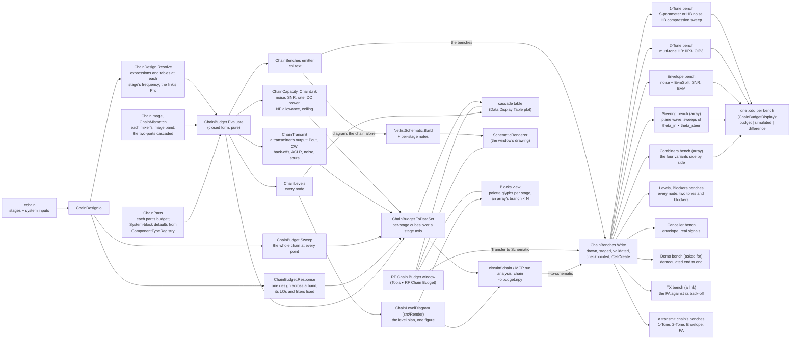

# RF chain budget

A receive or transmit chain's budget in closed form, and its transfer to test benches of circuitRF's own System blocks
whose simulations check every number of it. The user-facing page is `docs/user/src/reference/chain-budget.md`; this note is
how it is built and how it was verified.

## 1. Architecture

- **`src/Design/Chain`** — framework-free, below the firewall. `ChainDesign` and `ChainDesignIo` (the document),
  `ChainParts` (what each part does to a budget), `ChainBudget` (the cascade, and the same as a `DataSet`),
  `ChainBenches` (the transfer and the diagram). The emitter writes netlist TEXT and hands it to
  `NetlistSchematic.Build` — the drawing `circuitrf netlist --to-schematic` makes — with an `ExactPlacement` that puts an
  array's elements in rows. `Write` draws all the chain's benches, writes each into a temporary staging folder with
  `CellCreate.Create` (the function New Cell calls) and reads it back through `CellViewFileValidator`; only when every
  bench passes does it take a history checkpoint (`WorkspaceCheckpoints.BeforeWrite`) and create the cells in the
  workspace. `Diagram` emits the chain alone (ports in and out, no sources, analyses or isolators), draws it the same way
  and adds four text notes above each stage, its own and its cascaded numbers; it returns which drawn component belongs
  to which stage.
- **`src/Render/DataDisplay/ChainBudgetDisplay`** — the displays, ordinary Table plots. One per bench, of the bench's
  measurement rows, named after it, because `RunResultsWriter.AutoDisplayCandidates` opens an authored display beside
  the bench when the bench is simulated; and the window's cascade table, a Table plot over the budget `DataSet`'s stage
  axis.
- **`src/Cli/Chain.cs`** — the verb: parsing, refusals, reporting. `run analysis=chain` on the MCP server.
- **`src/Ui/Chain`, `src/Ui/Views/Chain`** — the window, a top-level tool window as the Match Designer's is: Tools ▸ RF
  Chain Budget, or a `.cchain` from the tree. It holds no budget arithmetic. The chain is drawn two ways: the
  Schematic tab, where `ChainSchematicCanvas` hands the diagram's model to `SchematicRenderer.Draw` with the renderer's
  own selection overlay; and the Blocks tab, an idealised block per stage — an `ItemsControl` of the palette's own
  `PaletteGlyphControl` symbols, an array's branch once with "× N", a combiner as its variant's levels — fed by the
  core's numbers. The cascade is a `PlotControl` over the Data Display table. A selection in either view and in the
  stage list is one `SelectedStage`.
- **`src/Core/Devices/System/CombinerModel`** — the library's N-way Combiner, an `IdealSBlockModel`: S(S,k) =
  10^(−IL_k/20)·e^(j·Phase_k)/√N, every other entry zero. It is the splitter, the direct combiner, each 2:1 of a tree
  and, with an Amp after it, the active combiner; its thermal noise comes from its S like every passive block's.

The benches are run by the analyses that already exist, and every check is a measurement row. The one addition below
the Design layer is the System Amplifier's bandpass laws (§2.5), which a transmit chain's PA needs and which every
schematic can use.

### 1.1 How it lines up with `docs/design/plugins.md`

It is a built-in tool, in one pull request, but shaped the way that note shapes a plugin, so that it could move to the
plugin route once the plugin runtime exists:

- **P-4, a function of its parameters.** `ChainBudget.Evaluate` is pure: a `.cchain` in, a result out, nothing read from
  the window or the workspace. The window, the verb and the test suite call the same function.
- **P-7, headless parity.** Everything the window does is a verb: `circuitrf chain` budgets a `.cchain` as a `DataSet`,
  `--to-schematic` transfers it, `check` reports its refusals, and the MCP server has it as `run analysis=chain`.
- **P-2, circuitRF draws every view.** The chain is a `.cnl` drawn as `netlist --to-schematic` draws one, rendered by
  `SchematicRenderer`; the cascade and every bench's comparison are Data Display Table and Rect plots (§5.1, §5.2). What
  the tool adds to the drawing is text: four `EditableText` notes per stage, which a plugin's `schematic` view (§5.4)
  has no field for today, so a plugin port would need the view to carry annotations or the notes to move into a Table.
  The Blocks view is the one drawing of the tool's own — XAML over the palette's glyphs, fed by the core — and the
  plugin vocabulary has no block-diagram view kind; a port would ask for one, or show the blocks as a Table. Its Levels
  strip is the other (§2.4): `ChainLevelDiagram` in `src/Render`, which the CLI's `--level-diagram` draws too.
- **P-5, circuitRF writes the workspace.** Transfer stages the benches, validates each one, takes a checkpoint, and only
  then creates the cells through `CellCreate`; a refusal leaves the workspace untouched. An existing bench is the
  Replace question, in the window and as `--replace` on the CLI.

By §14 a broadly useful calculator that fits circuitRF's standards is a pull request; that is the route taken here.

## 2. The parts

Seven parts are System blocks and carry that block's own parameters, with the block's own placement defaults read from
`ComponentTypeRegistry.DefaultParameters`, so a stage and a freshly placed block cannot disagree. The splitter and the
array combiner are the library's N-way Combiner, added with this tool (`system-components.md`, Combiner). The library
has no phase shifter or limiter; those two are composed of parts it does have, and so is the active combiner:

| Part | Placed as |
|---|---|
| PhaseShifter | `Amp` (gain −IL, NF, IIP3, `IP3Ref=Input`) + `TLIN` (Z0, E = phase at the stage's frequency) |
| Limiter | `Amp` (gain −IL, NF = IL, IIP3 = P1dB + 8.9625 dB) |
| Splitter | `Combiner` from its common port, output 1 followed, outputs 2…N terminated in Z0 |
| Combiner, Direct | one `Combiner` of N ways, `IL`, each path's `PathIL` as its `IL[k]` |
| Combiner, Tree | log2 N levels of 2:1 `Combiner`s, level l's part j fed by parts 2j−1 and 2j of level l−1 |
| Combiner, Active | either topology, an `Amp` (`Gain`, `NF`, `IIP3`, `IP3Ref=Input`) after each combiner |
| SnP | `SnP` on the file, other ports terminated in Z0; a stated NF or IIP3 an `Amp` of 0 dB after it (§2.1) |

An active combiner is a composition rather than a block of its own because the composition gives the same answers
with no new model: its noise, gain and intercept are an Amp's, after a passive combiner's.

**The variants' budget** is the cascade of their levels (`CombinerSpec.Budget`): the paths' weights a_k first —
coherent (Σa_k)²/N², incoherent Σa_k²/N, T0·(N/Σa_k² − 1) of noise by Bosma on the weighting network — then each
level's passive part (n·g signal, g noise, T0·(1/g − 1)) and, active, its amplifier, cascaded with Friis on the noise
gains and the intercept sum on the signal gains. The stage then enters the chain's cascade with that signal gain,
noise gain, noise figure and intercept, and the chain's array gain becomes the product of each stage's signal over
noise gain, (Σa_k)²/Σa_k² for the combiner. A tree with N not a power of 2 is refused, Direct named as the remedy,
rather than given uneven levels: an uneven tree's paths have unequal losses, which is what `PathIL` already states.

### 2.1 S-parameter data

An `SnP` stage is a Touchstone file on the library's SnP block (`ChainSnp`). The budget reads the file through
`TouchstoneCache` with the block's own interpolation (cubic spline in magnitude and phase, in S), at the stage's INPUT
frequency (`ChainDesign.StageInputFrequencies`: the chain's, moved by each mixer), renormalised to 50 Ω, the ports
other than `In` and `Out` terminated. Gain is |S(Out,In)|². Noise is what the S-parameter noise analysis gives the
placed block, so the bench checks it exactly: a two-port's noise rows (1 → 2) at a 50 Ω source, linear between rows
as `SnpModel.NoiseAt`; with none and σ_max(S) ≤ 1 + 10⁻⁶, Bosma on the network and its terminations at T0,
F = (1 − |S_oo|²)/|S_oi|²; with gain and none, nothing — the budget refuses rather than guess, until `NF` is stated.
A stated `NF` (not below the file's own F_file) or `IIP3` is placed as an ideal Amp of 0 dB after the block, its NF
1 + (F − F_file)·G and its input intercept IIP3 + G; a file with gain and no noise data is written `Noise=no`, so the
noise run lists it as stated rather than warning that it has no model.

Nothing is extrapolated: a stage frequency outside the file's range, or outside its noise rows when they set the NF,
is a refusal naming the stage; a blocker outside the range is carried at the edge value, as the block clamps it, with
a note. A relative `File` resolves against `ChainDesign.BaseDirectory` — the `.cchain`'s owning workspace by
`SchematicCircuit.ReferenceBaseOf`, which `LoadFromFile` sets — and the benches write it relative to the workspace they
land in when the file is under it, a full path otherwise. The window keeps an SnP stage that names no file yet instead
of undoing the pick, flags its File box and asks for a file (`ChainFileWanted`).

Measured on a matched three-stage chain (an LNA with noise data, a passive 3-port read 1 → 3, a gain block with NF and
IIP3 stated): 1-Tone gain and NF 4×10⁻¹⁵ dB from the budget, 2-Tone IIP3 1.6×10⁻⁴ dB
(`ChainBudgetTests.AnSnpStage_SimulatesToItsBudget`). The budget, like every stage's, ignores mismatch between stages
unless the chain asks for it (§2.6): matched, a file whose S11 or S22 is not small reads differently in the simulation.

### 2.2 The levels, the canceller and the demo

**`ChainLevels`** walks the budget's own cascade node by node — the signal, the noise floor in the bandwidth, the NF,
the IM3 of two tones at the input power, every blocker, a canceller's interference, the margin to compression and the
SNR. A blocker is carried through every stage's gain at its own frequency: a filter's response there comes from
`FilterNetwork`, the model the Filter block itself simulates with, so a blocker's rejection is the block's and not a
second filter formula; a mixer moves it to |f − Flo|.

**The canceller** (`CancellerSpec`) is composed: a Directional Coupler whose through arm is the main path and whose
isolated port takes the reference path. Its budget on the wanted signal is the through arm's loss and the reference
path's injected noise, F = L_t + (F_ref·G_ref − 1)·c/(1 − c); on the interference, the band average of
|1 − a·e^(j(φ − 2πfτ))|², R = 1 + a² − 2a·cos(φ − 2πντ)·sinc(πBτ). On the ordinary benches the reference path is only its
noise (an Amp of the gain it would need, from a T0 termination, or a T0 termination when passive); the Canceller bench
drives it with the interference itself.

**The demo** uses what the envelope run already measures at every IProbe — EVM, the constellation, EvmSplit's noise and
distortion parts and the in-channel SNR — over a sweep of the input power. Nothing demodulates but the envelope run.

### 2.3 Values of the frequency, the link and the readouts

**Resolution before everything.** `ChainBudget.Evaluate` first resolves the design (`ChainDesign.Resolve`,
`ChainScaling`): every stage parameter that names a `.csv` or is an expression reading only `freq` and `f_GHz` is
replaced by its number at its stage's input frequency, walking the chain from the input so that a mixer's `Flo` is
resolved before the frequency moves; then the link's inputs at the carrier, a fractional bandwidth into the bandwidth,
and the link's received power into the input power. A value that cannot be read refuses the chain; the resolved design's
own `Refusals()` run after. The result keeps that design (`ChainBudgetResult.Design`), and the levels, the diagram, the
block view, the displays and the emitter all read it, so a bench carries exactly the number its budget used. The
expression could not go onto the netlist instead: an ideal block does not bind `freq` (`FreqDeferral` lets only a few
models do so), and the budget's own reading of a table must be the bench's. A number is written round-trip (`"R"`), not
with `ChainValue.Format`'s six decimals.

**Budget-only parameters.** `ChainParam.BudgetOnly` marks what the budget reads and no part's netlist line carries: every
part's `Pdc` and an Amplifier's `GainPerStage`. `Emitter.Params` skips them; the window leaves a blank one out of the
stage, so a chain that uses neither saves byte for byte as before. The stage count is ⌈G/g − 10⁻⁹⌉: without the 10⁻⁹,
20/5 can read 4.000000000000001 and count five.

**The link** (`ChainLink`) is two parameter sets, `Tx` and `Path`, as a stage's are, so the window edits them with the
stage rows' own editor. They are not stages: a stage before the combiner is one element's branch, and the input-referred
noise is per element. The receive array is the chain's Combiner. The link's received power is the chain's input power,
held at the ceiling `IP1dB − RxBackoffDb` (the ceiling computed from the stages' budgets before the cascade, which is
the only place the input power enters), so every bench runs unchanged at the power the link delivers. The distance has
its own reader: to `ChainValue` (and to `Units`) a lone `m` is the milli prefix.

**The readouts** (`ChainCapacity`, `ChainLink.Power`) are functions of the result alone. The array's noise factor is
not a new calculation: the cascade's per-element noise factor F over its array gain A is, in linear terms,
F/A = F_A/M + (F_B − 1)/G_A for equal paths (A = M) and F_A/A + (F_B − 1)/G_A with a `PathIL` taper, exactly, with F_A
taken to the combiner's output and G_A the gain to there with the array gain in; the readout is 10·log10(F/A). The combiner is the matched convention (N in-phase signals out at N times one element's
power, noise once); a voltage-summing convention reads 10·log10 N higher after the combiner and the same SNR.

**`Topology = Levels`** is one N:1 combiner with ⌈log2 N⌉·IL of loss: a tree's budget for any N, which a receive-array
sweep through 6 or 11 elements needs, verified by the same Direct bench. The tree keeps its refusal for N not a power
of 2, since a real uneven tree has unequal paths.

**The sweeps** (`ChainBudget.Sweep`) evaluate the whole design again at every point, from the unresolved design, so the
expressions and tables move. A point is one chain: its own copy drops the sweeps, or an Mrx of 1 (no combiner left)
would be refused for sweeping a combiner it no longer has. At a point of a `Frequency` sweep every Filter is its own
response there (`ChainStageContext.Response`), so a band written as numbers rolls off as the carrier leaves it, and an
in-band point carries its ripple; until §2.6 it was its IL at every carrier and a note said so. An array's sweeps move
no frequency and keep each Filter's IL, so their point at the design's own size is the budget.

### 2.4 The level diagram

**One figure, three callers.** `ChainLevelDiagram` (`src/Render/Chain`) draws a chain's level plan: the nodes along x, and
at each, in dBm, the signal, the noise floor, the sensitivity (MDS + the required SNR, carried by the gain), the IM3,
every blocker, a canceller's interference and the compression limit (the cumulative OP1dB at the node, from the first
stage that compresses); between them the SNR (noise to signal) and the headroom (signal to P1dB) filled, and the SFDR,
(2/3)·(OIP3 − noise) above the noise floor, hatched, because it overlaps both and three tints over each other read as
one grey. A band at one node alone is a narrow bar, so the key never names a band nobody can see. The signal's, the
noise floor's and the P1dB's values are written at every node on a halo of the page, so they read over a band's tint,
every line's at the output, and in a key the SNR, the SFDR and the budget's margin to P1dB at the output, naming the
carrier that sets it. The numbers are `ChainLevels`' own: it gained the compression, the
sensitivity and the SFDR per node, and nothing in the renderer computes a level. The Blocks view's Levels strip draws
it with each node on a gap between two blocks; `circuitrf chain --level-diagram` and the docs draw it on its own, the
nodes evenly spaced. `ChainLevelDiagram.NodesBetween` is the one rule for where a node stands under a lineup — the
window applies it to the blocks as laid out, the Copy's picture to the blocks as it draws them.

**A transmit chain's** (§2.5) is the same figure read toward the output: the signal named Pout; the Psat referred to
each node (`ChainTransmit.PsatAtNodes`, the recursion the readout's Psat ends in) dashed over the P1dB and held in the
window's top; and a key of the back-off from both, the noise floor in dBm/Hz and the ACLR estimate, the readouts'
own (`ChainTransmit.Read`). The sensitivity and the SFDR are left out; a receiver's plan carries none of it.

**Not a Data Display plot**, because a level plan shades between its lines, writes its values at the nodes and, under
the blocks, puts its nodes where the gaps are, which a linear axis cannot. It takes the same window rule
(`ChainBudgetDisplay.LevelWindow`); the diagram's window also holds the P1dB, the sensitivity and the EIRP.

**What the figure handles.**
- *An array*: the nodes up to the combiner carry one element's levels, as the blocks draw that branch once ("× N"),
  and are marked "each of N elements"; at the combiner the signal steps up by its coherent gain and the noise by less.
- *Conversions*: the frequency of each run of nodes is written over it, a dashed line at each mixer.
- *A link*: a left-hand segment before node 0 rather than nodes of its own, because the transmitter and the path are
  not stages (§2.3) and stand under no block. Its one point is the EIRP; the segment falls to the power each element
  receives with the path's loss written on it, and the ceiling is marked at the input. Where the arrival is above the
  ceiling it is drawn hollow and held down to it, as the budget holds the input.

**The window rule** (`LevelWindow`, `NodeWindow`): the top 10 dB over every level drawn, the bottom 20 dB under every
level but the IM3, each rounded out to 10 dB; x half a node beyond the input and the output. The IM3 reaches the top
only because two tones far under the noise floor took a third to two thirds of the height (63 % on a 30-stage chain);
a plot clips it and its legend says "IM3 (clipped)", and the diagram puts a ▼ on its bottom edge at the node, so a
real IM3, even at −374 dBm on a 200 km link, never vanishes. Only finite levels count. **The budget has no stand-in**:
an absent level is NaN or −∞. A filter that passes nothing at a blocker's frequency (a band-pass at 0 Hz, where a mixer
put it) gives `ChainLevels.GainAt` −∞, which absorbs every gain after it; it was −300 dB, which a 60 dB IF amplifier
brought back as a blocker at −260 dBm. A bench's measurement row needs a number, so the bench alone writes
`ChainBenches.Absent`, −300 (+300 for a margin that never compresses), and the window reads exactly that value of a
bench's results as none. The display draws the IM3, the interference and the margin only over the nodes where they
exist (a kept range of the node axis). The dB plot reaches 10 dB beyond its NF, SNR and margin (`DbWindow`).

**Format version 2** is written only when a chain uses what version 1 does not have (a new field, an expression, a table
or a budget-only parameter), so a 1.8.2 reader refuses such a chain rather than dropping the fields on save, and a
plain chain stays readable there.

### 2.5 Transmit chains, the amplifier's laws and the IQ modulator

**A direction, not a second budget.** `ChainDesign.Direction` is Receive or Transmit; the cascade is the same function
and every row the same numbers. A transmit chain's readouts (`ChainTransmit`) are read from the result at the output:
the linear Pout, the CW output through every stage's compression, the back-offs, the ACLR estimate, the noise floor and a
receive band's noise, and an IQ modulator's image and LO. The ACLR relation is derived in the reference page: a cubic on
the complex envelope, a complex Gaussian signal with a flat spectrum (Isserlis' theorem for its moments, the threefold
convolution for where its distortion falls; Reed's theorem for the complex Gaussian's), the adjacent channel the
signal's width one bandwidth away:
ACLR = 2·(Pout − OIP3) − 10·log10 3.

**Nothing a receive chain writes changes.** A parameter that has a value meaning "as before" says so
(`ChainParam.Implied`: an Amplifier's `Law` = Tanh, `Psat`, `P`, `PhiSat`, `PhiMax` at their defaults, a Mixer's
`Sideband` = Lower), and such a value is written nowhere: not into the stage by the window, not onto a bench's line.
Format version 3 is written only for what version 2 does not have, so a version-2 reader refuses a transmit chain
rather than budgeting it as a receiver; every shipped receive chain and bench is the same to the byte.

**A converter's sideband** is one function, `ChainParts.OutputHz`, which every frequency walk now calls: the stage
frequencies, the expressions' reading, the blockers' levels, the benches' product tracking (`Emitter.Convert`, the
sum moving a product up by the LO).

**The laws live in Core** (`AmplifierLaw`), shared by the Amplifier that simulates them and the budget that predicts
them. A bandpass law acts on the envelope, so the amplifier applies it to the analytic signal: u = Re{F(s)·(x + j·x̂)},
s = κ·(x² + x̂²), F(0) = 1, the gain staying in the block's own admittance. One tone has a constant envelope and comes
out as the law at that drive and nothing else; the Jacobian is written with D = s·dF/ds, finite at s = 0 for every
smoothness. x̂ is a third port of the amplifier on a net the Elaborator mints, held at the input's Hilbert transform by
`AmplifierQuadratureModel`, a LINEAR companion: i_q = G·(v_q + j·sign(ω)·v_in). The quadrature had to be linear.
The single-tone Newton carries a device's weighted terms (the H[w] buckets a hybrid's passive intermod uses), but the
2-D and N-tone Newtons and the multi-fundamental envelope carry only conduction and charge, and drop the rest without
a word; a linear stamp is made per frequency by every one of them. The companion's quadrature is zero below 1 kHz, so
DC and the envelope's baseband product (stamped at 1 and 2 Hz) see none. The amplifier's line still binds four nets
(`InstanceNetContract`), its noise is its NF through its two RF ports, and the companion is noiseless by definition.
Measured in the envelope too: a Saleh amplifier driven by a 20 MHz NR carrier reads its instantaneous gain on the
law to 5×10⁻⁵ dB and its phase to 1.4×10⁻⁴° over every sample above −20 dBm.

**Rapp's intercept is the cubic's at its 1 dB point.** Rapp's law has no third-order term at p ≠ 1, and an intercept
sum needs one. The cubic with the same 1 dB point is the textbook IP3 = P1dB + 9.64 dB. For p = 2 it is pessimistic
for two tones away from compression (the 2-Tone bench's IM3 4.1 dB under it at the operating point) and optimistic for
a noise-like carrier there, whose peaks reach past the 1 dB point, where Rapp clips harder than the cubic: the PA alone
reads its NR carrier's ACLR 0.8 dB worse than the estimate.

**The IQ modulator** is composed of library blocks: a 90° Hybrid splits the input into I and Q, a Combiner splits the
LO into its quadrature (±90° plus the phase error), two Mixers convert (the Q one's gain plus the gain error) and a
Combiner sums them (`IqModSpec`). The LO's split is a Combiner rather than a second hybrid because a hybrid set off
quadrature is not passive, and a block that is not passive has no thermal noise in a noise run, which says so in a
warning on every run of the bench.

**The benches.** A transmit chain gets 1-Tone, 2-Tone, Envelope and PA benches (`ChainBenches.TxMeasurements`,
`EmitPa`). A budget curve over a drive sweep is a Lagrange cube over the swept values (`SweepCube`), the Levels
benches' node cube generalised, exact at the points. Every analysis goes through the same pre-write checks as a receive
chain's (`Order`, `EnvelopeFits`); an IQ modulator's LO is a converter's tone like a mixer's.

### 2.6 The response, the image band and the cascade with mismatch

**Off the carrier, a Filter is its response.** `ChainStageContext.Response` is the one switch: set for a response's point,
a sweep's point and an image, a Filter's budget is its own network there (`FilterNetwork`, the block's model) between
50 Ω, G = |S21|² and F = (1 − |S22|²)/|S21|² (Bosma). The prototype is lossless and the IL a flat factor on S21, so that F
is the IL at every frequency; the gain is where the roll-off shows. At the carrier the switch is off and the Filter is
its IL, as before: a single budget is unchanged to the byte.

**The response** (`ChainBudget.Response`, `ChainResponse`) is the design budgeted at its carrier, then again at each
input frequency of the band with every frequency parameter (`ChainScaling.IsFrequency`, a parameter whose unit is a
frequency: an LO, a filter's band, a canceller's bandwidth) left where the carrier resolved it and every other value of
the frequency read at the frequency its stage then sees (`ChainScaling.At`). That one rule separates the design from
the device: `F1 = freq - 4GHz` placed the preselector for the carrier and stays put; `NF = 0.05*f_GHz + 0.6` is the
LNA's and moves. The input power and the bandwidth are the carrier's; the link is not read again. It is a group of its
own (`Response`) beside the sweeps', over an axis named `offset` or `freq`, Hz, so the file format, the DataSet, the
window and the CLI all keep it apart from the carrier sweep.

**The image band** (`ChainImage`). The budget's Friis sum takes each mixer's SSB figure, which holds T0 at the image. The
excess over that is walked from the source at the image's own frequency through the stages in front of the mixer, every
stage read there as its block is, and referred to the input by the signal path's noise gain to the mixer: ΔTe =
(T_im − T0)/Gn. Three choices make the walk agree with the benches rather than with an idealisation:

- *A passive stage with S-parameters delivers T0·(1 − |S21|² − |S22|²)*, not T0·(1 − |S21|²): the System Amplifier's NF is
  one noise wave into its input and nothing out of it, so a stopband in front of an amplifier feeds it almost nothing.
  `ChainTransmit`'s receive band found the same (§3).
- *The mixer's input adds T0·|S22|² of the stage before it*: the isolator the benches place in front of a mixer sends its
  terminated port's noise back out of its input, and that stage reflects it in. With a filter right before the mixer the
  two together are T0 + |S21|²·(T − T0), T0 in the stopband, so a preselector that rejects the image adds nothing.
- *Through an earlier mixer, both inputs that convert to the frequency*, f + Flo and |f − Flo|, each through its own
  isolator, and the mixer's own noise as its SSB figure less the two sidebands' T0. A converter is read with its
  carrier's numbers, the one number its block carries for both sidebands.

Each term is a vector over the source and the stages, so a stage's share of F − 1 holds the noise it sends through an
image, which is what a noise run's shares (`NFc`) hold. The source's own image-band noise is no part's in a run and no
stage's here; with an image counted the shares sum to less than 100 %, and the 1-Tone bench's per-stage NF, which a run
builds from its shares, is compared with the budget's same sum (`ChainBenches`, `nfAt`) rather than with the chain cut
at the stage, which then differs from it.

**The threshold.** Counting every image exactly moves every number of every chain with a mixer by 10⁻⁶ to 10⁻⁴ dB, and
the benches carry the budget's numbers round-trip, so every shipped bench would change in its last digits. An image is
counted when it moves the NF by `ChainImage.ThresholdDb` = 0.001 dB or more: below the window's precision and every
tolerance a bench is read to, above what the shipped preselectors let through (`ChainFidelityTests`, which prints them:
the 26 GHz link's 4.36×10⁻⁴ dB, the dual conversion's second image 5.96×10⁻⁵ dB, the superhet's 8.66×10⁻⁶ dB). Every
shipped chain and bench is the same to the byte. The price is a step: across a response or a sweep an image that crosses
the threshold between two points moves the NF by 0.001 dB at once (on a slope of 10⁻⁵ dB per MHz, measured), and two
mixers each just under it are both left out. A file read outside its range at an image is taken at its nearest
frequency, as the block takes it, and noted, as a blocker outside a file is.

**The cascade with mismatch** (`ChainMismatch`). Each stage a two-port at its own input frequency: S at 50 Ω and its
chain correlation matrix C_A (RfCore's `NoiseMetrics`: `ChainCorrelation` from noise parameters, Bosma's
Cs = kT0·(I − S·Sᴴ) through `AdmittanceCorrelation` and `ChainFromAdmittance`). The cascade is A = Π A_k and
C_A = Σ (Π_(j<k) A_j)·C_k·(Π_(j<k) A_j)ᴴ (Hillbrand & Russer), F = 1 + (C11·|Ys|² + 2·Re(Ys·C12) + C22)/(4kT0·Re Ys) at
Ys = 1/50 Ω, G_T = |S21|² of the cascade; term k is stage k's share. ABCD comes from S by the textbook table, which needs
S21 ≠ 0; a stage with none there refuses the chain. A stage with no S data is its budget's matched two-port: passive and
reciprocal for an attenuator, a switch, a coupler's through arm and a splitter (Bosma); an isolator with no reverse path;
every other stage unilateral with one input noise wave (Fmin = F, Zopt = 50 Ω, Rn = (F − 1)·50/4, the Amplifier's own
NF model). So a chain of ideal stages cascades to the Friis budget, to 10⁻⁶ dB on the superhet (the filters' tiny
S11 at a carrier off their geometric centre is the rest). Two things the benches place go into the cascade too: the
isolator in front of each mixer (S = [[0, 0], [1, 0]], kT0 out of its input), and the matched 0 dB amplifier after an
SnP stage with a stated NF or intercept, which stops what the next stage sends back. Without the latter the S-parameter
noise bench read 1.6×10⁻⁴ dB off: the attenuator after the second file sent its own noise backward into that file's S22.

**What with mismatch does not reach.** The intercept and compression sums take each stage's own figure with the gain to
its nonlinearity between 50 Ω, which is the input of every block (matched) and the amplifier after an SnP file; the
per-element view of an array's combiner is a unilateral two-port of its noise gain, its coherent gain the array's; an
image whose mixer has a converter before it is walked between 50 Ω. A level at a node between two reflecting stages is
the chain up to it into 50 Ω, and the Levels bench reads that node's voltage, which holds the reflected wave as well:
20·log10|(1 + Γ_L)/(1 − S22·Γ_L)| above the budget's level, the reflected wave and the multiple reflection between the
stage (S22) and its load (Γ_L), and |1 + Γin| at the input.

## 3. The benches, and what was found building them

**The mixer's image termination.** A mixer's SSB noise figure is stated with its image at T0. In a chain a filter in
front of the mixer reflects the image instead, and the ideal Mixer's equivalent noise current then develops a different
noise voltage there (an open-like reflection about four times the matched one). Measured on the superhet: harmonic-balance
NF 2.833 dB against Friis' 2.549 dB without anything in front of the mixer, 2.5489 dB with an isolator — a circulator whose
third port is terminated at the ambient, i.e. a T0 termination at the image. The benches place one, as the bench's and
not the chain's, and the docs say what removing it shows.

**Mixing order on a lattice with an LO.** Each LO raises every product's order by one. With MaxMixOrder 5 on (f1, f2, LO)
the IF stages' IM3 read 0.012 dB off; at 6 (5 + mixers) 1.8×10⁻⁴ dB, and 7 or 9 change nothing. The compression sweep
likewise converges at 3 + 2·mixers (0.088 dB → 0.048 dB → 0.047 dB at 3, 5, 7). The HB noise run needs 1 + 2·mixers to
keep the image sideband, and its output frequency is offset 1 kHz from the IF, where the noise at the IF is defined: on
the lattice point itself the run returns NaN, by design.

**A swept variable in a measurement is the sweep's axis.** In a schematic with a sweep over `Pin`, every measurement
reading `Pin` reads the swept cube, including one for a different analysis. The 1-Tone bench keeps its small-signal drive
in its own variable, `Pss`, and sets `Pin = Pss`. The Steering bench uses the same fact on purpose: its closed-form
array factor reads `theta_in` and `theta_steer` and comes out as a cube over both sweeps, aligned with the simulated
pattern by axis name.

**Two limits of measurement expressions over a sweep's cube, met on the Steering bench.** `sin`, `cos` and `exp` take a
number, not a cube ("Value is Cube, not Complex"), while `^` broadcasts; the bench writes e^(j·x) as
`2.718281828459045^(j*x)` and sin x as its imaginary part. And a variable DERIVED from a swept one (`psi_in =
…sin(theta_in…)`) reads its nominal value in a measurement, not the swept cube, though the circuit sees it swept; so the
array factor is written from `theta_in` and `theta_steer` themselves.

**A harmonic-balance result has an axis called `node`.** Its voltage cube's nets are on an axis of that name, so a
measurement reading a variable called `node` read the nets instead (ten of them, not the seven nodes swept). The
Levels displays' variable is `nodeix`.

**One number per node, one curve.** A display draws a cube against its axis; a bench's measurements are one number per
node. Each Levels bench sweeps `nodeix` over 0 … n around a trivial DC solve and writes each curve as
Σ v_k·L_k(nodeix), L_k the Lagrange basis polynomial that is 1 at node k and 0 at the others — exact at the integers in
arithmetic alone, the only operations a sweep's cube takes.

**A node's voltage is not its forward wave before a reflective stopband.** On the first Blockers run the 150 MHz
blocker read 3.1 dB high at the LNA's output and 5.8 dB high after the mixer: the filter after each reflects it, and the
node's voltage is the incident wave plus the reflection. The Blockers bench puts an ideal isolator after every stage,
so each node sees a match and reads the wave going forward, which is what the budget carries; the blockers then sit on
the budget to their own compression of the LNA, 0.001 to 0.003 dB.

**Blockers and the two tones are two runs.** In one harmonic-balance run, four tones and an LO on the mixing order the
IF's IM3 needs (5 + mixers) is some 1,800 frequencies; at 3 + mixers the run takes 34 s and the IF's IM3 reads 0.45 dB
off. The Levels bench runs the two tones alone on the 2-Tone bench's order (7 s, IM3 within 10⁻⁴ dB) and the Blockers
bench the blockers alone (3 s).

**A DBPSK carrier is its source's only one,** so the demo's DBPSK has its own source, joined to the NR one by a 2-way
Combiner.

**A preselector is what keeps the mixer's image quiet.** A first frequency-scaled test chain, an LNA straight into a
mixer, read its HB noise figure 2.96 dB above the budget at 140 GHz and 2.77 dB at 2.45 GHz: the isolator in front of
the mixer passes the LNA's amplified noise at the image sideband, which the budget (and an SSB figure) assumes filtered.
A preselector between them (`F1 = freq - 4GHz`, `F2 = freq + 4GHz`, following the carrier) brings it to 3×10⁻⁴ dB. The
26 GHz example has one for the same reason. The budget now counts the image (§2.6): the superhet's LNA straight into its
mixer reads its harmonic-balance NF 2.8×10⁻⁵ dB from the budget, 2.44 dB of it the image's.

**A single-tone harmonic-balance index is a harmonic, not a mix index.** `HB1.V("out", 1)`, not `"(1)"`: a lattice of one
tone has a harmonic axis, and the measurement written for a mix index evaluates to nothing.

**An ideal PA saturates 3.92 dB below its output intercept.** The tanh limiter's fundamental saturates at (4/π)·Vsat in
amplitude and its intercept is 2·Vsat, so Psat = OIP3 − 10·log10(π²/4). Harmonic balance 30 dB past it reads Psat less
0.0022 dB, the describing function's own shortfall there (0.022 dB at 20 dB, 0.24 dB at 10 dB). The TX bench's PA is
an Amplifier of `IP3 = Psat + 3.9224 dBm`.

**A flat phase needs a behavioural part.** A TLIN's phase is a delay as well, so the Canceller bench's phase setting is
one path of a 2-way Combiner, whose `Phase[k]` is flat, and its delay a line.

**A splitter-fed plane wave gives each element its own noise.** One Port into a lossless N-way Combiner used as a
splitter: by Bosma the splitter's isolation network puts kT0·(I − s·s†) on its outputs and the Port's termination
kT0·s·s†, so each element sees kT0 of its own, uncorrelated with the others — what an element of a real array receives
from its own antenna. The NF from that Port at the beam's peak is then one element's, for any steer angle; with unequal
paths it is the budget's plus the taper's loss, 10·log10 N − (Σa_k)²/Σa_k², because the splitter shares the wave equally
where the combiner weighs it unequally.

**More than one mixer: what one run holds, and the conversions.** Each LO is a tone, and three limits stop a
dual-conversion chain's benches as one run each, measured on a 2.45 GHz → 350 MHz → 10.7 MHz receiver before the fix:
the 1-Tone bench's harmonic-balance noise run takes one or two tones (three refused); the 2-Tone and Levels runs on
four tones at 5 + mixers = 7 retain 1,121 mixing products, over the 600 cap; the Envelope and Demo runs would need a
third fundamental. `ChainBenches.Build` now checks every analysis before a bench is written (`Emitter.Order`,
`Emitter.EnvelopeFits`): the highest mixing order at or below the converged one that the cap takes and on which no
product the bench reads shares a frequency with another, down to the least that carries what the bench reads, else a
refusal. Two products on one frequency that the bench reads neither of are run, and said. A bench refused as the
whole chain is written per conversion (`ChainBenches.Conversions`): conversion k from the stage after mixer k − 1 to
mixer k, so the filter in front of each mixer is in its conversion; driven at the budget's level and frequency there,
the blockers as they arrive there, and a source temperature of the noise delivered there, (Ts + Te)·Gn, which makes
its SNR and noise floor the whole chain's at every node. The 1-Tone, Levels and Blockers benches split together, since
the Levels display reads all three, and a display draws no trace of a bench that is not written. The 2-Tone bench stays
whole at MaxMixOrder 5 (341 products), 1.5 to 3 minutes, and reads its intercepts 3×10⁻³ dB high,
against 2×10⁻⁴ dB at the order a single mixer's converge at.

**The second envelope LO, and blockers on images.** An envelope run takes a tone as a fundamental of its own only more
than three of a carrier's bandwidths from it: a 10.7 MHz second IF puts the second LO 10.7 MHz from the 5 MHz NR
carrier at the first IF, so that conversion's Envelope and Demo are left out; the example uses 21.4 MHz. Blockers
exactly on both mixers' images put two products on 10.7 MHz (in one run, (1,0,−1,2) and (0,1,−1,0) on 328.6 MHz as
well): the harmonic-balance run does not refuse that, it reads the blocker 9.53 dB high at the first IF. With the second
blocker 1 MHz off the image the same run reads 0.0025 dB. A coincidence on a product the bench reads now lowers the
order or refuses the bench. One on products it does not read is milder and common: blockers spaced evenly (±10 and
±20 MHz) put their differences on one frequency and read 0.008 to 0.009 dB under the budget, against 0.002 dB just off
it, so such a bench runs and Transfer says so; there an IM3 of three blockers on the fourth, which the bench reads,
takes the order from 3 to 2. An envelope run refuses any coincidence at its MaxMixOrder: a superhet at 2.4 GHz with its
LO at 1.6 GHz puts the IF, 800 MHz, on 2·2.4 − 1.6 GHz too, and `EnvelopeFits` now leaves that Envelope bench out.

**An LO above the signal.** Two defects that a single high-side mixer already had, found here: the IF's tracked product
index is then the conjugate of the half-space one the lattice keeps, so every row naming it failed to resolve; and the
noise run's input sideband went through the RF tone's index, (2, −1), where the signal reaches the IF through the LO,
(0, −1): NF 103 dB. The bench now names the kept product, and the sideband is −v₁ over the LOs alone. A blocker below a
low-side LO, on its image, is inverted the same way after the mixer: its rows now name (1,0,−1) where they named
(−1,0,1), which did not resolve. Apart from those, and a bench whose runs needed the order lowered or could not be held
at all, a single-mixer chain's benches are unchanged; the shipped ones to the byte.

**Three things the budget assumes, met in the example's design.** With the IF amplifier between the image filter and
MIX2, the amplifier's own noise at MIX2's image reached the mixer: the second conversion's NF read 1.4 dB over its
budget. The example puts the amplifier ahead of the image filter. With nothing between MIX1 and that amplifier, the
amplifier saw MIX1's sum product at 4.55 GHz, and its third-order term mixed it with the IF onto the IF's own IM3,
(f₁ + f_LO) + (f₁ − f_LO) − (f₂ + f_LO) = 2f₁ − f₂ − f_LO: the whole chain's IIP3 read 0.44 dB under the budget, which
takes each stage's IM3 from the wanted signal alone. A roofing filter in front of the amplifier brings it to 1.6×10⁻³ dB
(3rd order, 300 to 400 MHz) or 3.1×10⁻³ dB (the example's, 5th order, 200 to 600 MHz), the four-tone run's own truncation
at MaxMixOrder 5; a per-conversion
2-Tone bench would not have shown it, its source being the clean IF. And a narrow 3rd-order second IF filter (18.6 to
24.6 MHz) reflected 14 % at the IM3 frequencies, so the node before it read the IM3 1.1 dB low, and its skirt took
0.08 dB off the output's IM3 (the first whole-chain 2-Tone's +0.038 dB); a 5th-order filter of 13.6 to 33.6 MHz keeps
the Levels on the budget to 4×10⁻⁴ dB.

**A transmit chain's benches.** Four things found building them:

- *The sideband the composition selects.* The first IQ modulator split its LO with the Combiner's path at −90°, the
  hybrid's convention, and the bench read the wanted sideband 35 dB down and the image up: the Combiner's path phase is
  e^(+jφ). The bench tracks the wanted product, its image and its LO by index, so it read the swap at once.
- *A node in front of a reflection.* The modulator's image and LO at its output read 5.4 and 2.6 dB off their closed
  forms: the band filter after it reflects both, and a node's voltage there is the incident wave and the reflected one.
  An isolator after the modulator, the bench's, puts both on their closed forms to 10⁻³ and 10⁻² dB.
- *Bosma in the stopband.* The receive band's noise first read 2.3 dB under the budget, which took a filter's noise
  figure as its loss at every frequency: in its stopband a lossless filter reflects, so the driver after it is fed
  almost no noise, where the loss rule assumed T0. A filter now adds T0·(1 − |S21|² − |S22|²), and the budget reads
  0.13 dB over the run.
- *Noise under compression.* The noise floor reads 0.145 dB under the budget at the operating point, 0.05 dB into the
  PA's compression: half of the noise is amplitude, which the PA passes at its AM gain there, 0.2245 dB under its
  small-signal gain, and half phase, at its CW gain; 0.134 dB expected.

The 2-Tone bench is the slowest: two baseband tones and the LO are three tones, and multi-tone harmonic balance at the
order its IM3 needs takes minutes per level, so it runs three levels. The Envelope bench's two fundamentals, the carrier
and the LO, take about two minutes per drive point.

## 4. Verification

`testdata/chain/plot_chain_compare.py` runs the example's superhet and array, and an RF-only array, through the CLI
and plots the budget against the simulation, stage by stage:

Everything that is exact in the budget is within the benches' drive levels: 3×10⁻¹⁰ dB in gain and NF from the
S-parameter analysis, 10⁻⁴ dB from harmonic balance at 40 dB below compression and two tones 50 dB below the intercept.
The four combiner variants, each transferred and run, read the same (gain and NF to 10⁻⁶ dB, intercepts to 10⁻³ dB,
`ChainBudgetTests.EveryCombinerVariant_SimulatesToItsBudget`), and on the example's Combiners bench gain and NF to
10⁻¹⁴ dB. The Steering bench's pattern is the closed-form array factor to 3×10⁻⁹ dB within 3 dB of each peak and 10⁻⁶ dB
down to −60 dB:

The levels, the canceller and the demo, read from the example's benches as the GUI simulates them:

- **Levels**: the signal at every node to 2×10⁻⁵ dB, the IM3 to 8×10⁻⁵ dB; each blocker 0.001 to 0.003 dB under the
  budget, its own slight compression at −40 and −50 dBm (`ChainBudgetExampleTests.Superhet_LevelsAndBlockers_EveryNodeOnTheBudget`).
- **The canceller's noise**: the front end's 1-Tone NF on F = L_t + (F_ref·G_ref − 1)·c/(1 − c) to 10⁻⁶ dB.
- **The canceller's depth**: at three carriers (10 MHz centred, 5 MHz at −15 MHz, 20 MHz at +20 MHz) and every swept
  error, within 1.4 % of the closed form's depth, worst 0.7 dB at 49.7 dB deep, under 0.3 dB shallower than 45 dB. The
  wanted 64-QAM carrier's EVM goes from 840 % to 3.2 %, the QPSK one's from 1036 % to 8.6 %.

- **The demo**: the SNR 0.20 dB under the budget at the lowest power, the EVM's noise part 57.0 % against 1/√SNR's
  56.2 %. Higher, two floors the budget leaves out: the distortion part's 1.23 %, the LO mask integrated over the channel
  (−38.2 dBc), and a noise part that stops at about 1 %, 40 dB of SNR, for the DBPSK carrier too. The Canceller bench,
  with no LO and another chain, stops at 41 dB, so the floor belongs to the envelope measurement rather than to either
  chain; where in it is an open question. Past compression the distortion part is 15.5 %.

**The link and its readouts** have no circuit of their own: `testdata/chain/link_reference.py` (standard library only)
works a 26 GHz link out at five points (three carriers, a transmitter that meets the receiver's ceiling, a receive array
of six) and the budget agrees with its 140 numbers to 10⁻⁹ (`ChainLinkBudgetTests.TheLinkBudget_IsTheIndependentReference`).
The example's 26 GHz link checks the receiver at the −59.41 dBm its link delivers: 1-Tone −1.1×10⁻⁴ dB in gain and
+2.8×10⁻⁴ dB in NF, 2-Tone +8.7×10⁻⁴ dB in IIP3, Steering and Combiners 10⁻¹⁴ dB, Envelope −0.02 dB in SNR; its
Levels bench, two tones each at that power 24 dB under the input P1dB, −0.013 dB in signal and −0.030 dB in IM3 at the
mixer's output, their own compression. Its TX bench: 0.92 dB of compression and 6.3 % EVM at the 8 dB back-off, and
the PA 0.44 dB under Psat at 10 dB of overdrive. Two points of a frequency sweep, each transferred, read G and NF within
10⁻⁶ dB.

Two quantities are not exact and are said to be: the cascaded compression point is a formula of the intercept's form
and reads 0.02 to 0.06 dB early, and the envelope SNR is one record of noise, ±0.12 dB from seed to seed.

**The linear transmitter.** A standard-library calculation reproduces its budget (Pout, the CW output, both
back-offs, OIP3 and the ACLR, the noise floor and the receive band's noise, the image and the LO) to 10⁻⁶ dB, and each
law's 1 dB point and saturation by root-finding its own AM-AM. Its benches: the output over 38 dB of drive on the
budget's CW output to 5×10⁻⁴ dB (the Chebyshev ripple), the PA's AM-AM and AM-PM on Rapp's law to 10⁻⁹, the
modulator's image and LO on their closed forms, the noise 0.13 to 0.15 dB under (0.134 dB expected); the two-tone IM3
4.1 dB under the estimate; the ACLR 0.8 dB over it at the PA (the estimate is optimistic there, and the PA bench
asserts that sign) and 1.0 dB under it at the output, where the band filter after the PA removes 1.43 dB of the
regrowth. The hand calculation is `testdata/chain/tx_reference.py`, its numbers `tx_reference.json`, which
`ChainBudgetExampleTests.LinearTx_TheBudget_IsTheIndependentReference` holds the budget to at 10⁻⁶ dB
(`ChainBudgetExampleTests.LinearTx_*`, `ChainTransmitTests`, `AmplifierLawHbTests`).

**The response, the image band and the cascade with mismatch.** `testdata/chain/fidelity_reference.py` (standard library
only) works out a superhet whose RF filter passes the image, its response across ±60 MHz with the LO fixed (each
Butterworth filter's |S21|² = L/(1 + Ω^2n) at the point, Bosma's F for its noise, Friis with the image term) and its NF
at the carrier, and two amplifier files whose ports reflect, cascaded by Friis on available gains with each stage's noise
factor at the source it really sees (F = F1 + (F2(Γ = S22a) − 1)/G_A1, G_T = |S21a·S21b/(1 − S22a·S11b)|²): another
route than the chain correlation matrices the budget takes. The budget agrees with its 65 numbers to 10⁻⁹ dB
(`ChainFidelityTests.TheResponseTheImageAndTheMismatch_AreTheIndependentReference`). Against the benches: the superhet
with an image-passing RF filter, harmonic-balance noise, NF 3.7×10⁻⁵ dB, every stage's from the run's shares within
6×10⁻⁵ dB; its LNA straight into its mixer 2.8×10⁻⁵ dB, 2.44 dB of the NF the image's; two reflecting amplifier files, a
Chebyshev filter and an attenuator with mismatch, the S-parameter noise bench 10⁻¹⁴ dB in gain and 7×10⁻¹⁶ dB in NF, where
matched the budget reads 1.27 dB off in gain. The wideband example, the image and the mismatch both in it, reads its
1-Tone bench's NF to 1.9×10⁻⁵ dB and gain to −1.1×10⁻⁴ dB (every stage's to 3×10⁻⁵ dB), its 2-Tone IIP3 to 2.2×10⁻⁴ dB,
its Levels from the LNA on to 7×10⁻⁴ dB and its envelope SNR to −0.14 dB.

## 5. References

Friis 1944 (doi:10.1109/JRPROC.1944.232049); Pozar, *Microwave Engineering*, 4th ed., §10.1 and §10.3; Razavi,
*RF Microelectronics*, 2nd ed., §2.2–2.3; Wilkinson 1960 (doi:10.1109/TMTT.1960.1124668); Van Trees, *Optimum Array
Processing*, §2.2. The link: Friis 1946 (doi:10.1109/JRPROC.1946.234568), the free-space transmission formula;
Shannon 1948 (doi:10.1002/j.1538-7305.1948.tb01338.x), the capacity of a band-limited channel in Gaussian noise.
The transmitter: C. Rapp, "Effects of HPA-nonlinearity on 4-DPSK/OFDM-signal for a digital sound broadcasting system",
Proc. 2nd European Conference on Satellite Communications, 1991; A. A. M. Saleh, "Frequency-independent and
frequency-dependent nonlinear models of TWT amplifiers", IEEE Trans. Communications 29(11), 1981; L. Isserlis, "On a
formula for the product-moment coefficient of any order of a normal frequency distribution in any number of
variables", Biometrika 12, 1918; I. S. Reed, "On a moment theorem for complex Gaussian processes", IRE Trans.
Information Theory 8(3), 1962. The response, the image band and the cascade with mismatch: H. Hillbrand and P. H. Russer,
"An efficient method for computer aided noise analysis of linear amplifier networks", IEEE Trans. Circuits and Systems
23(4), 1976 (doi:10.1109/TCS.1976.1084200), the chain correlation matrices and their cascade; H. Bosma, "On the theory of
linear noisy systems", Philips Research Reports Supplements 10, 1967, a passive network's noise from its S; Pozar,
*Microwave Engineering*, 4th ed., §8.3–8.4 (a Butterworth response and the bandpass transformation), §10.2 (the
cascade's noise figure on available gains) and §12.1, §12.3 (a two-port's power gains, and its noise figure from its
noise parameters); Razavi, *RF Microelectronics*, 2nd ed., ch. 6 (a mixer's noise figure, its image band). The
feature list of RxCalc (https://github.com/arhiv6/rxcalc, GPL-3) is the inspiration; only its
README was read, and no code is taken from it.
