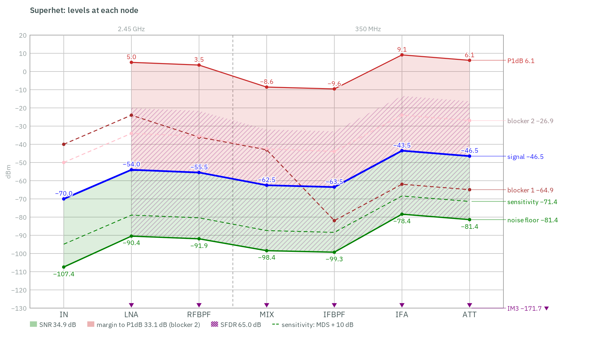
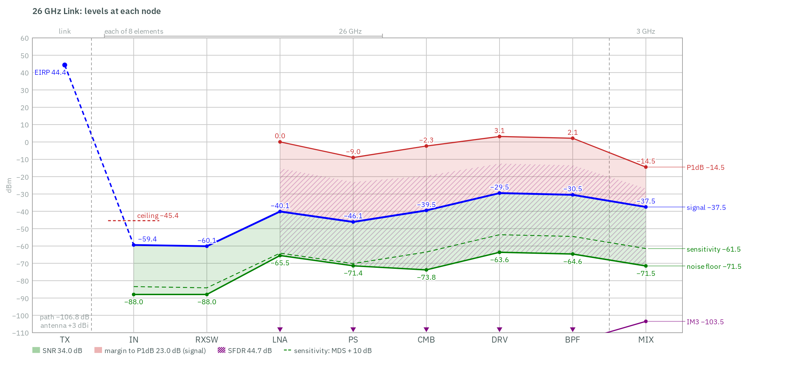

# RF Chain Budget

**Open a `.cchain` and the RF Chain Budget window shows its cascade.** The benches beside it are its Transfer to
Schematic: open one, Simulate, and its Data Display opens with the budget's number beside every simulated one.

Four receive chains at 2.45 GHz, in the same 4.5 MHz bandwidth, each already transferred:

1. **`Superhet.cchain`**: an LNA, an RF bandpass filter, a mixer to a 350 MHz IF, an IF filter, an IF amplifier and an
   attenuator. Every stage is a System block with its own parameters.
2. **`Array.cchain`**: four elements, each an LNA and a phase shifter, into a 4-way combiner steered 45° per element, then
   the superhet's receiver from the RF filter on. The combiner is the library's N-way Combiner; the phase shifter is
   composed of the library's own parts, an amplifier and a line.
3. **`Front End.cchain`**: a canceller in front of an LNA, a filter and a second amplifier. The canceller subtracts a
   copy of a −40 dBm interference, 20 dB over the wanted signal, through a 10 dB coupler, with 0.02 dB, 0.2° and 0.05 ns
   of error in its reference path: 47 dB of depth.
4. **`Dual Conversion.cchain`**: the superhet's front end to a 350 MHz first IF, then a roofing filter, an IF amplifier,
   an image filter and a second mixer to a 21.4 MHz second IF, an IF filter and an amplifier. Two mixers are more than
   one simulation run holds, so most of its benches are written once per conversion (below).

The superhet also has two blockers at its input, 150 MHz and 20 MHz above the signal, and asks for the demo bench. The
dual-conversion receiver has one blocker on each mixer's image, and asks for the demo bench too.

And a link: **`26 GHz Link.cchain`**, a 16-element transmitter 200 m from an 8-element receiver at 26 GHz, in NR band
n258 (24.25 to 27.5 GHz), whose stages scale with the frequency. See [The 26 GHz link](#the-26-ghz-link).

And a transmitter: **`Linear TX.cchain`**, a 3.5 GHz chain for a 100 MHz NR carrier at 30 kHz subcarrier spacing, from an
IQ modulator to a PA with Rapp's law and a band filter. See [The linear transmitter](#the-linear-transmitter).

And two that start from a digital stream, both at 3.5 GHz for a 20 MHz NR carrier: **`Digital TX.cchain`**, two DACs
and their reconstruction filters into an IQ modulator, a driver, a PA with Rapp's law and a band filter; and
**`Polar TX.cchain`**, the stream's amplitude and phase recombined in a supply-modulated amplifier. See
[The digital and polar transmitters](#the-digital-and-polar-transmitters).

The formulas, the parts and the benches are in *Reference ▸ RF Chain Budget*.

## The chains

| Stage | Part | Gain | NF | Intercept |
|---|---|---|---|---|
| LNA | `Amp` | 16 dB | 1 dB | OIP3 15 dBm |
| RFBPF | `Filter`, 3rd-order Butterworth, 2.35 to 2.55 GHz | −1.5 dB | 1.5 dB | |
| MIX | `Mixer`, LO 2.1 GHz at 7 dBm | −7 dB | 7 dB SSB | IIP3 10 dBm |
| IFBPF | `Filter`, 3rd-order Butterworth, 320 to 380 MHz | −1 dB | 1 dB | |
| IFA | `Amp` | 20 dB | 4 dB | OIP3 25 dBm |
| ATT | `Atten` | −3 dB | 3 dB | |

The array replaces the LNA with four branches of an `Amp` (18 dB, NF 1.2 dB, OIP3 10 dBm) and a `PhaseShifter` (5 dB of
loss, NF 5 dB, IIP3 15 dBm), and a `Combiner` (N = 4, direct and passive, 0.5 dB of excess loss, `Steer` = 45°; its
active variants' amplifiers 10 dB, NF 2 dB, IIP3 10 dBm).

| | Superhet | Array, per element |
|---|---|---|
| Gain | 23.50 dB | 26.02 dB (6.02 dB of it the array's) |
| NF | 2.55 dB | 4.09 dB |
| IIP3 / OIP3 | −7.40 / 16.10 dBm | −12.00 / 14.02 dBm |
| IP1dB / OP1dB | −16.36 / 6.14 dBm | −20.97 / 4.05 dBm |
| MDS in 4.5 MHz | −104.89 dBm | −109.37 dBm |
| Sensitivity at 10 dB SNR | −94.89 dBm | −99.37 dBm |
| SNR | 34.89 dB at −70 dBm | 29.37 dB at −80 dBm |
| SFDR | 65.00 dB | 64.91 dB |

**The array's NF is one element's, and its SNR is four elements' signal.** Four in-phase signals add in amplitude and
their uncorrelated noise in power, so the combiner gains 6.02 dB of signal and none of noise. The SNR rises by
10·log10 4 = 6.02 dB over one element's, and the MDS per element falls by as much. Its NF, 4.09 dB, is that of one
element's branch, the combiner's loss and the receiver after it, by Friis' formula. It is higher than the superhet's
because the phase shifter's 5 dB comes right after the LNA.

The dual-conversion receiver, stage by stage:

| Stage | Part | Gain | NF | Intercept |
|---|---|---|---|---|
| LNA, RFBPF, MIX1 | as the superhet's, the LO at 2.1 GHz | | | |
| IF1BPF | `Filter`, 5th-order Butterworth, 200 to 600 MHz | −1 dB | 1 dB | |
| IF1A | `Amp` | 15 dB | 3 dB | OIP3 25 dBm |
| IMGBPF | `Filter`, 5th-order Butterworth, 335 to 365 MHz | −2 dB | 2 dB | |
| MIX2 | `Mixer`, LO 328.6 MHz at 7 dBm | −6 dB | 8 dB SSB | IIP3 15 dBm |
| IF2BPF | `Filter`, 5th-order Butterworth, 13.6 to 33.6 MHz | −1 dB | 1 dB | |
| IF2A | `Amp` | 20 dB | 5 dB | OIP3 30 dBm |

| | Dual conversion | to IF1 (LNA to MIX1) | from IF1 (IF1BPF to IF2A) |
|---|---|---|---|
| Gain | 32.50 dB | 7.50 dB | 25.00 dB |
| NF | 2.74 dB | 1.50 dB | 5.59 dB |
| IIP3 / OIP3 | −9.60 / 22.90 dBm | −6.10 / 1.40 dBm | 0.47 / 25.47 dBm |
| IP1dB / OP1dB | −18.56 / 12.94 dBm | −15.07 / −8.57 dBm | −8.49 / 15.51 dBm |
| MDS in 4.5 MHz | −104.71 dBm | | |
| Sensitivity at 10 dB SNR | −94.71 dBm | | |
| SNR | 34.71 dB at −70 dBm | 35.95 dB at IF1 | 34.71 dB at the output |
| SFDR | 63.40 dB | | |

**The two conversions make the whole chain by the same sums.** F = F₁ + (F₂ − 1)/G₁ = 1.4116 + 2.6190/5.6234 = 1.8774,
2.74 dB; 1/IIP3 = 1/IIP3₁ + G₁/IIP3₂ = 4.0773 + 5.6234 × 0.8968 = 9.1207 mW⁻¹, −9.60 dBm. The second conversion starts
at MIX1's output, −62.5 dBm at 350 MHz. Its Envelope and Demo sources are at 2302 K, the noise the first delivers, so
the SNR they measure is the whole chain's at every node; its 1-Tone source is at 290 K, where a noise figure is stated.

**Each mixer's image filter is right in front of it**, as the budget takes it: the RF filter before MIX1, IMGBPF before
MIX2, with the IF amplifier ahead of it. With the amplifier between the image filter and MIX2 instead, its own noise at
MIX2's image reaches the mixer, and the second conversion's NF reads 1.4 dB over its budget. **And a roofing filter,
IF1BPF, comes before the IF amplifier**: without it IF1A sees MIX1's sum product at 4.55 GHz, and its third-order term
mixes that with the IF onto the IF's own IM3, which the budget does not have. The whole chain's IIP3 then reads 0.44 dB
under the budget.

**Try it.** In the array's window set the combiner's `N` to 8: the array gain becomes 9.03 dB and the SNR rises 3 dB,
while the NF does not move. Set its `Topology` to Tree and the block view draws three levels of 2:1; set `Kind` to Active
and an amplifier follows each.

## The benches

Each chain has these three, written by **Transfer to Schematic**, and a Levels bench (below); the array has two more:

- **`1-Tone`**: a P1Tone per element and a Port at the output. With the mixer, harmonic-balance noise with the LO
  running gives the SSB NF and the conversion gain; a drive sweep at the predicted IP1dB gives the compression point.
- **`2-Tone`**: a PnTone per element, two tones 1 MHz apart, 50 dB below the predicted IIP3. The intercepts, and each
  stage's gain and OIP3 at its output.
- **`Envelope`**: a MOD_Source per element sending an NR 5 MHz carrier, its 50 Ω noisy at 290 K. The SNR in the carrier's
  4.5 MHz and the EVM's noise part.

In front of the mixer each bench has an **isolator**, a circulator with its third port terminated: it terminates the
mixer's image at 290 K, which is what its SSB noise figure is stated against. Delete it from `Superhet 1-Tone` and the
NF reads 0.28 dB higher: the RF filter reflects the image instead of terminating it, and the mixer's own noise source
then develops more noise there than across a matched termination.

In the array each element has a line in front of it, `PATH2` to `PATH4`: the arriving wave's extra path, 45° per element.
Each element's phase shifter is set to take it out again, so the four arrive at the combiner in phase.

- **`Array Steering`**: a plane wave into the four elements — one Port into a Combiner used as a splitter, its path k
  delayed by the wave's extra path — steered by the phase shifters from the VAR block's `theta_steer`, and read at the
  combiner. A sweep of `theta_in` from −90° to 90° within a sweep of `theta_steer` over −30°, 0° and 30° draws the
  array pattern, and beside it the closed-form array factor. Set `taper` to 6 and the sidelobes fall; set
  `d_over_lambda` to 1 and grating lobes appear.
- **`Array Combiners`**: the same four elements into each of the combiner's four variants, side by side, each from its
  own wave at broadside: gain and NF from one S-parameter run, beside each variant's budget.

| Variant | Gain | NF | IIP3 | OIP3 |
|---|---|---|---|---|
| Direct, passive | 18.52 dB | 1.33 dB | −9.19 dBm | 9.33 dBm |
| Tree, passive | 18.02 dB | 1.35 dB | −9.19 dBm | 8.83 dBm |
| Direct, active | 28.52 dB | 1.43 dB | −11.88 dBm | 16.64 dBm |
| Tree, active | 38.02 dB | 1.45 dB | −18.77 dBm | 19.26 dBm |

A tree's loss accumulates level by level (two 2:1 levels of 0.5 dB against one 4:1 of 0.5 dB); an active combiner's
noise figure is set by its first amplifier and its intercept by its last, which sees the most power. All four keep the
6.02 dB array gain.

## The 26 GHz link

A transmit array, a line-of-sight path and a receive array, on the window's **Link** tab, in front of a receiver whose
stages are written as values of the frequency. Every coefficient is an illustrative one of this example's own, picked
to look like a 26 GHz front end; none is a fit to any device or process.

| Transmitter | | Path | |
|---|---|---|---|
| `Psat` | `freq < 30e9 ? 32.5 - 6*log10(f_GHz) : 45.79 - 15*log10(f_GHz)` dBm: 24.01 dBm at 26 GHz, a knee at 30 GHz | `Distance` | 200 m |
| `Backoff` | 8 dB | `Attenuation` | `Atmospheric attenuation.csv`: illustrative dB/km, a gentle water-vapour bump at 22 GHz |
| `Loss` | `0.012*f_GHz + 0.4` dB (a switch): 0.71 dB | `RxAntennaGain` | 3 dBi |
| `AntennaGain`, `Elements` | 5 dBi, 16 | | |
| `PaGain`, `PAE` | 20 dB, `max(32 - 12*log10(f_GHz), 5)` %: 15.0 % | | |

| Stage | Part | At 26 GHz |
|---|---|---|
| RXSW | `Switch`, `IL = 0.012*f_GHz + 0.4` | 0.71 dB |
| LNA | `Amp`, 20 dB, `NF = 0.045*f_GHz + 1.29`, IIP3 −10 dBm, `GainPerStage = 33 - 15*log10(f_GHz)`, 8 mW a stage | NF 2.46 dB; 11.8 dB a stage, so 2 stages (3 above 34 GHz) |
| PS | `PhaseShifter`, 6 dB, IIP3 10 dBm | |
| CMB | `Combiner`, N = 8, `Topology = Levels`, 0.8 dB a level, steer 30° | 3 levels: 2.4 dB |
| DRV | `Amp`, 10 dB, the LNA's NF, OIP3 15 dBm, 15 mW | |
| BPF | `Filter`, a preselector that follows the carrier: `F1 = freq - 1.5GHz`, `F2 = freq + 1.5GHz`, 1 dB | |
| MIX | `Mixer`, −7 dB, NF 9 dB, IIP3 3 dBm, `Flo = freq - 3GHz`, 25 mW | a 3 GHz IF at every carrier |

400 MHz of bandwidth (an FR2 channel), two streams (two polarisations), a required SNR of 10 dB. Worked out by hand:

| | |
|---|---|
| PA output | 24.01 − 8 = 16.01 dBm |
| EIRP | 16.01 − 0.71 + 5 + 20·log10 16 = 44.38 dBm |
| Free space | 20·log10(4π · 200 m · 26 GHz / c) = 106.77 dB, and 0.09 dB/km × 0.2 km = 0.02 dB more |
| At each receive element | 44.38 − 106.77 − 0.02 + 3 = −59.41 dBm, below the receiver's ceiling of −45.38 dBm |
| Noise at the input | kT0B in 400 MHz is −87.96 dBm; the element's NF 3.58 dB, less the array gain 9.03 dB: −93.40 dBm |
| SNR, margin | 34.00 dB, 24.00 dB |
| Rate | 2 · 400 MHz · log2(1 + 10^3.4) = 9.04 Gb/s |
| DC power | 16 PAs of (39.9 − 0.4) mW / 15.0 % = 263 mW, 4.21 W; 8 elements of 16 mW, and 40 mW after the combiner, 0.17 W; ×2 streams: 8.75 W |
| Energy per bit | 8.75 W / 9.04 Gb/s = 969 pJ/bit |

The mixer sets the receiver's compression (89 % of its 1/IP1dB): it comes after the combiner, where the eight
elements' signals arrive in phase, and the Notes say so. The cascade table's **NF left** column says the stages after
the LNA may have 16.7 dB of NF together before they cost the chain 1 dB.

**The sweeps.** The Link tab's Sweeps row asks for three, each with its own tab:
- the carrier from 20 to 40 GHz, beyond n258 to show the trend: the rate falls from 9.9 to 7.2 Gb/s as the PA's output
  falls past its knee, the loss and the noise rise, and the free-space loss rises, since a fixed-gain element's aperture
  shrinks with the wavelength; and the DC power steps where the LNA needs a third stage;
- the transmit array from 4 to 1024 elements: the rate climbs until the received power meets the receiver's ceiling,
  then stops;
- the receive array from 1 (no combiner) to 64 elements, sizes that are not powers of 2 among them, which the Levels
  topology takes.

**The benches.** The link adds a **`26 GHz Link TX`** bench: one transmit element's PA under an NR 64-QAM carrier,
swept over its back-off. At the link's 8 dB the output is 0.92 dB below the budget's Psat − 8 dB, the EVM 6.3 % and the
adjacent-channel ratio −30.3 dBc; at 12 dB, 0.41 dB, 2.9 % and −36.9 dBc. The receiver's own benches run at the
−59.41 dBm the link delivers to each element: its 1-Tone bench reads −0.0001 dB in gain and +0.0003 dB in NF, its
Steering and Combiners benches 10⁻¹⁴ dB, its 2-Tone bench +9×10⁻⁴ dB in IIP3 and +6×10⁻⁴ dB in OIP3. Its Levels bench
drives two tones each at the link's −59.41 dBm, 24 dB under the receiver's input P1dB, and reads the signal within
0.0015 dB of the budget up to the filter and 0.013 dB under it at the mixer's output, the IM3 0.030 dB under: the tones'
own slight compression, at the power the link really delivers.
Its Envelope bench, eight NR carriers of 50 MHz each noisy at 290 K, reads the SNR in the carrier's 48.6 MHz 0.02 dB
under the budget's 43.15 dB, and the output power 0.006 dB under. The benches' NR carriers use 15 kHz subcarriers, where
an n258 channel would use 60 or 120 kHz; the spacing changes neither the budget nor what these memoryless blocks do to
a carrier's SNR and EVM.

## Levels, blockers, the canceller and the demo

- **`<chain> Levels`** (every chain): two tones at the input power, the signal and its IM3 at every node. Its display
  puts them beside the budget's, with the noise floor and NF from the 1-Tone bench, each blocker from the Blockers
  bench, and the SNR and the margin to compression, all against the node (0 the input, k stage k's output).
- **`Superhet Blockers`**: the blockers alone, an isolator after every stage so each node reads the wave going forward.
  The RF filter takes 10 dB off the one at 150 MHz; after the mixer it is at 500 MHz, and the IF filter takes 38 dB more.
- **`Front End Canceller`**: the canceller with real signals. A wanted 64-QAM and QPSK pair under a three-carrier
  interference (10, 5 and 20 MHz), each from a MOD_Source the Signal Designer edits. Its display: the depth against the
  phase error, the amplitude error and the delay mismatch at each interference carrier, simulated beside the closed form;
  the wanted carriers' EVM and SNR, and their constellations, with and without cancellation. Set `phase_err` or
  `delay_err` in its VAR block and Simulate again.
- **`Superhet Demo`**: the superhet demodulated end to end, NR 64-QAM and DBPSK, the LO with a phase-noise mask, the input
  power swept from noise-limited to compression-limited: the constellation, the EVM beside the budget's 1/√SNR, and its
  noise and distortion parts.

### The level diagram

Tick **Levels** in the Blocks view and each chain's level plan is drawn under its blocks, a node on each gap: the
signal, the noise floor, the sensitivity, the IM3, every blocker and the P1dB at every node, the SNR and the headroom
shaded between them and the SFDR hatched. `circuitrf chain Superhet.cchain --level-diagram superhet-levels.png` draws
the same figure on its own:

The 26 GHz link's starts in front of its input: the 16 transmit elements' EIRP, the path down to the −59.4 dBm each
receive element gets, and the receiver's ceiling, 14 dB above it. Up to the combiner the levels are one element's.

## Two conversions

`Dual Conversion` is written as two chains: `Dual Conversion IF1 …`, the front end to MIX1's output at 350 MHz, and
`Dual Conversion IF2 …`, from there to the output at 21.4 MHz. Each has its own 1-Tone, Levels, Blockers, Envelope and
Demo bench, and each display sets the simulation beside that conversion's own budget. One harmonic-balance noise run
takes two tones and one envelope run two fundamentals, and every LO is one, so no single run of these holds both mixers.
The 2-Tone bench is one run of the whole chain: four tones at MaxMixOrder 5, the most the 600-product cap allows.

The second conversion's benches start at MIX1's output: their sources are at 350 MHz and −62.5 dBm, the level MIX1
delivers. The Envelope and Demo sources are also at 2302 K, the noise MIX1 delivers (the MOD_Source's `Temp`,
2028.93 °C), so the SNR they measure is the whole chain's, node by node; the 1-Tone bench's source is at 290 K, the
temperature its NF is stated at.

**Images.** The budget takes each image as filtered; a blocker at an image's offset shows how well. Blocker 1, at
−40 dBm, sits on MIX1's image, 700 MHz below the signal at 1.75 GHz. The RF filter takes 55.4 dB off it beyond its IL,
and after MIX1 it is on the IF itself, at 350 MHz and then at 21.4 MHz: at the output 25.4 dB under the signal, which it
was 30 dB over at the input. Blocker 2, at −50 dBm, sits 1 MHz inside MIX2's image band, 41.8 MHz below the signal. The
RF filter and the roofing filter pass it, MIX1 moves it to 308.2 MHz, IMGBPF takes 47.0 dB off it, and MIX2 puts it at 20.4 MHz,
inside the second IF's channel, 27.0 dB under the signal. Exactly on the image, it would land on the same frequency as
blocker 1 after MIX2, which a harmonic-balance run cannot tell apart, and Transfer would leave that Blockers bench out
and say so.

## The linear transmitter

`Linear TX.cchain` is a transmit chain (**Direction** Transmit): driven at its input, read at its output.

| Stage | Part | Gain | NF | Compression |
|---|---|---|---|---|
| IQ | `IQMod`: a 90° hybrid, two mixers and their LO's quadrature, 3.3 GHz at 7 dBm, the upper sideband; 0.2 dB and 1.5° of imbalance, 50 dB of LO isolation | −5.90 dB | 12 dB | IIP3 18.01 dBm |
| BPF1 | `Filter`, 5th-order Butterworth, 3.4 to 3.6 GHz | −1.5 dB | 1.5 dB | |
| DRV | `Amp` | 20 dB | 4 dB | OIP3 32 dBm |
| PA | `Amp`, `Law` Rapp: `Psat` 37 dBm, `P` 2; `Pdc` 10 W | 30 dB | 6 dB | IP1dB 5.84 dBm |
| BPF2 | `Filter`, 5th-order 0.1 dB Chebyshev, 3.4 to 3.6 GHz | −0.6 dB | 0.6 dB | |

Its input is a 200 MHz IF at −14 dBm, high enough that the LO, 200 MHz below the carrier, and the image, 400 MHz below,
clear the 100 MHz carrier's adjacent channels; the band filters then take both down. Its receive band is 20 MHz wide,
200 MHz above the carrier.

| | Linear TX |
|---|---|
| Gain, NF | 42.00 dB, 14.14 dB |
| Output | 28.00 dBm; a CW carrier 27.95 dBm, 0.05 dB into compression |
| Back-off | 6.04 dB from OP1dB 34.04 dBm, 8.40 dB from Psat 36.40 dBm |
| OIP3, ACLR | 44.65 dBm, −38.07 dBc by 2·(Pout − OIP3) − 4.77 dB |
| Noise | −117.84 dBm/Hz at the output; −83.49 dBm in the receive band |
| Image, LO | rejected 35.17 dB at the modulator, −167.82 dBc at the output; −23.22 dBc at the modulator, −90.27 dBc at the output |

Its [level diagram](#the-level-diagram) is read toward the output: the output power at every node, the P1dB and, dashed
over it, the Psat each node's stages allow, with the back-off from both, the noise floor and the ACLR estimate in its
key. The PA takes the output from −1.4 to 28.6 dBm and sets both limits:

**The PA's intercept is the cubic's at its 1 dB point.** Rapp's law at `P` = 2 has no third-order term: its IM3 rises
5 dB per dB. The budget gives it the intercept a cubic compressing where it does would have, 15.47 dBm in, and the ACLR
estimate follows from that. The benches show what the law does instead: the 2-Tone bench's IM3 at the operating point
is −43.41 dBc against the estimate's −39.32; 20 dB down it reads an intercept of 57.15 dBm, the driver's and the
mixers' third order (57.64 dBm on their own) with the PA's residual fifth-order IM3 in phase. For an NR carrier the
estimate is optimistic at the PA: its own bench reads −37.73 and −37.86 dBc of ACLR against −38.51 estimated, the
carrier's peaks reaching past the 1 dB point, where Rapp clips harder than the cubic. At the chain's output the Envelope
bench reads −39.07 dBc against −38.07: the band filter after the PA removes 1.43 dB of the regrowth.

**Its benches**, each against the budget:

- **`Linear TX 1-Tone`**: the output over the drive, from 20 dB back to 10 dB past saturation, on the budget's CW output to
  5×10⁻⁴ dB, the Chebyshev filter's ripple at 3.5 GHz; the 1 dB point 0.10 dB later than the cascaded formula's; the
  modulator's image and LO on their closed forms at its own output (behind an isolator, the bench's: the filter
  reflects both); the noise 0.15 dB under the budget 1 MHz off the carrier and 0.13 dB in the receive band, half of it
  amplitude noise, which the PA passes 0.2245 dB under its gain at its operating point: 0.134 dB expected.
- **`Linear TX 2-Tone`**: two tones at three levels, the IQ modulator's LO the third tone of the run: at the operating
  point the IM3 4.1 dB under the cubic's estimate, and 20 dB down an intercept of 57.15 dBm, the driver's and mixers'
  third order (57.64 dBm) with the PA's residual fifth-order IM3 in phase.
- **`Linear TX Envelope`**: the NR carrier at the operating point and 3 dB either side: at the operating point 27.65 dBm,
  0.35 dB under the linear budget as its peaks compress, ACLR −39.07 dBc and 4.09 % EVM, the IQ modulator's 35 dB image
  rejection in it.
- **`Linear TX PA`**: the PA alone at its own input, from a MOD_Source: the harmonic-balance sweep of its AM-AM and
  AM-PM on Rapp's law to 10⁻⁹, its 1 dB point within 0.01 dB, its efficiency the power it adds over its 10 W; and the
  NR carrier through it, 28.38 dBm out, −37.73 and −37.86 dBc of ACLR, 2.53 % EVM, 6.88 % efficiency.

The 2-Tone bench takes several minutes (three tones in harmonic balance at the order its IM3 needs) and the Envelope
bench a few (two fundamentals, the carrier and the LO).

**Try it.** Set the PA's `P` to 3 and its 1 dB point moves to 0.01 dB under its saturated input: a harder PA, the same
back-off, and the budget's estimate rises with its cubic. Set `Law` to Saleh with `PhiSat` 10° and `PhiMax` 20°, and
its intercept takes the AM-PM into its third-order term. Set the IQ modulator's `PhaseImb` to 0 and `GainImb` to 0 and
the image goes; set `IsoLO_IF` to 200 and so does the LO.

## The digital and polar transmitters

Both start from a stream: a 20 MHz NR carrier at 15 kHz subcarrier spacing, 19.08 MHz occupied, which is the chain's
bandwidth. A stream has no thermal noise of its own, so the source is at 0 K. Their benches drive the stream itself,
and harmonic balance has none, so each has an Envelope bench (and the digital one its PA's).

`Digital TX.cchain` is a zero-IF transmitter, its input at 0 Hz, −10 dBm on each of its two rails:

| Stage | Part | Gain | Its budget |
|---|---|---|---|
| DAC | `DAC`: 6 bits across ±0.32 V, NRZ at 122.88 MHz, one per rail | 0 dB | 10.10 dB below full scale: SQNR 27.78 dB over the 122.88 MHz, 35.87 dB in the 19.08 MHz (8.09 dB of processing gain) |
| LPF | `Filter`, 5th-order Butterworth low-pass at 49.152 MHz (0.4·Fs), one per rail | −0.5 dB | |
| IQ | `IQMod`, LO 3.5 GHz, the upper sideband, taking the two rails as I and Q | −3.99 dB | each mixer −7 dB and IIP3 25 dBm; the rails' two powers add |
| DRV | `Amp` | 20 dB | OIP3 38 dBm |
| PA | `Amp`, `Law` Rapp: `Psat` 43 dBm, `P` 2; `Pdc` 10 W | 22 dB | 15.5 dB under its Psat |
| BPF | `Filter`, 5th-order 0.1 dB Chebyshev, 3.4 to 3.6 GHz | −0.6 dB | |

| | Digital TX |
|---|---|
| Output | 26.91 dBm, 12.61 dB under OP1dB and 15.49 dB under Psat |
| EVM floor | 1.64 %: the DAC's floor, 35.87 dB under the signal in the channel, and the hold's droop across it, 0.30 % |
| ACLR | −36.15 dBc: the DAC's floor in the adjacent channel, with the intercepts' −51.03 dBc |
| DAC image | −21.50 dB at the DAC, 113.34 MHz from the carrier; −60.58 dBc at the output, after both filters |

Six bits make the DAC the transmitter's floor, as in the System Design examples' DigitalTx at the same rate: each bit
more is 6 dB less of it, each doubling of Fs 3 dB.

`Polar TX.cchain` is two stages: `POL`, a `PolarTx` (`Ks` 10, an 80 MHz third-order amplitude path, 1 ns of mismatch,
the amplitude the later) and the same band filter. Its input is the stream at 0 dBm:

| | Polar TX |
|---|---|
| Output | 19.40 dBm: 0 dBm and 20·log10 `Ks` = 20 dB, less the filter's 0.6 dB |
| EVM floor | 1.143 %: the mismatch's √0.436·π·B·dT/√12, 1.7304 % over the band and 1.1426 % of it in the channel; the amplitude path's 80 MHz, 0.018 % |
| ACLR | −41.98 dBc: 0.215 of the mismatch's error in each adjacent channel, and the band filter's slope there |

The mismatch is the polar transmitter's own limit: EVM in proportion to the delay and the bandwidth, ACLR 6 dB worse for
each doubling. 80 MHz, four times the bandwidth, leaves the amplitude path well out of it.

Their level diagrams show the stream's own floor: the DAC's noise line from its node on, and the EVM floor and the ACLR
in the key.

**Their benches**, each against the budget:

- **`Digital TX Envelope`**: the stream's two rails, each through its own DAC and low-pass, into the IQ modulator's two
  mixers, the NR carrier at −10 dBm per rail and 3 dB either side. At the operating point 26.86 dBm against 26.91,
  ACLR −36.33 and −36.46 dBc against −36.15 (the DAC's floor alone is −36.29: the intercepts' share is the cubic's at
  the PA's 1 dB point, pessimistic this far back), and 1.68 % of EVM against the 1.64 % floor: the record's own floor adds 0.37 % in
  quadrature. 3 dB down it reads 2.31 % against 2.29 %; 3 dB up the DAC is 7.1 dB
  under full scale and its peaks clip, 1.77 % against the 1.18 % the floor would give, which the budget notes.
- **`Digital TX PA`**: the PA alone at its own input, as the linear transmitter's: Rapp's AM-AM and AM-PM over the drive
  to 10⁻⁹ and its 1 dB point within 0.01 dB. The NR carrier through it reads −64.4 and −64.1 dBc of ACLR against the
  −52.7 the cubic gives it: 15 dB under Psat, Rapp's IM3 has fallen at five times the drive.
- **`Polar TX Envelope`**: the polar pair, the amplitude through 1 ns and the 80 MHz low-pass into the supply-modulated
  amplifier, the phase turning a limited carrier, delayed by the low-pass's own 3.98 ns. 19.40 dBm at every drive on the
  budget to 0.001 dB, ACLR −41.69 and −41.70 dBc against −41.98, and 1.22 % of EVM against 1.14 %: 0.42 % more in
  quadrature, the record's own floor and the amplitude path at the run's 2 ns step, as the System Design examples'
  PolarTx reads at the same point.

Each runs a minute or two (the stream at baseband beside the carrier, 0.25 ms at the standard step).

**Try it.** Give the DAC 8 bits and its floor drops 12 dB: the EVM floor goes to 0.50 %, the floor and the droop
together, and the ACLR to −46.4 dBc, where the intercepts' share starts to show. Set `Fs` to 245.76 MHz instead and the floor
falls 3 dB and the droop to a quarter: 1.14 % of EVM. On the polar transmitter, set `dT`
to 2 ns and the EVM doubles; set it to 0 and `Fam` to 40 MHz, and the amplitude path's own error shows.

## What the displays show

Every number below is the simulation minus the budget.

| | Superhet | Array |
|---|---|---|
| Gain | −0.0001 dB | −0.0001 dB |
| NF | +0.0001 dB | +0.0001 dB |
| IIP3 | +0.0002 dB | +0.0002 dB |
| IP1dB | +0.048 dB | +0.062 dB |
| SNR | −0.13 dB | −0.27 dB |

The gain, NF and intercepts agree to the drive levels the benches use. The compression point is the cascaded-P1dB
formula's own approximation: two stages compressing at similar levels compress a little later together. The SNR is one
noise record's: four seeds of the array read 29.17 to 29.42 dB against 29.37 dB.

The array's Steering pattern sits on the closed-form array factor to 3×10⁻⁹ dB within 3 dB of each peak, and its gain,
NF and array gain at each peak, like every variant's gain and NF on the Combiners bench, to 10⁻¹⁴ dB: an S-parameter run
of ideal blocks has no drive level to differ by.

The superhet's levels sit on the budget to 2×10⁻⁵ dB (signal) and 8×10⁻⁵ dB (IM3) at every node, its blockers 0.001 to
0.003 dB under it, the blockers' own slight compression. The canceller's depth is the closed form's to 1.4 % of the
depth at every carrier and error, and cancelling takes the 64-QAM carrier's EVM from 840 % to 3.2 %. The demo's SNR is
the budget's to 0.2 dB where noise dominates; above that the LO's phase noise holds the EVM at 1.2 % until compression.

The dual-conversion receiver, each conversion against its own budget:

| | To IF1 | From IF1 |
|---|---|---|
| Gain | −0.0001 dB | −0.0001 dB |
| NF, and each stage's | +0.00003 dB | +0.0001 dB |
| IP1dB | +0.033 dB | +0.044 dB |
| Signal and IM3, every node | 0.00001 and 0.00003 dB | 0.00001 and 0.0003 dB |
| SNR | −0.45 dB | +0.02 dB |

The two conversions' simulated gains added, and their noise factors cascaded by Friis, land on the whole chain's budget
to −0.0002 dB and +0.0001 dB. The whole chain's 2-Tone bench reads its IIP3 0.003 dB high: four tones on the order the cap allows. The
first conversion's SNR is 0.45 dB under its budget because its output is MIX1's: with 7.5 dB of gain over a noise
factor of 1.41, the load's own noise, which the budget leaves out, is an eighth of what reaches it (0.52 dB).

**Run the bench first.** A display reads `results/<bench>.npy`, which Simulate writes. Measured wall clock, release build:

| Bench | Superhet | Array | Dual Conversion, each conversion | 26 GHz Link |
|---|---|---|---|---|
| 1-Tone | 3 s | 6 s | 4 s | 1 s |
| 2-Tone | 7 s | 50 s | 1.5 to 3 min, the whole chain | 3 min |
| Envelope | 9 s | 25 s | 12 s, 18 s | 33 min |
| Steering | | 2 s | | 2 s |
| Combiners | | 1 s | | 1 s |
| Levels | 7 s | | 4 s, 7 s | 4 min |
| Blockers | 3 s | | 1 s | |
| Demo | 2 min 20 s | | 1 min 45 s, 3 min | |
| TX | | | | 35 s to 1 min |

The link's harmonic-balance and envelope benches are slow for their eight elements, each a source of its own, and the
envelope one for its 50 MHz NR carrier, ten times the others'.

The Front End's Canceller bench runs its envelope sweeps in about 40 s.
